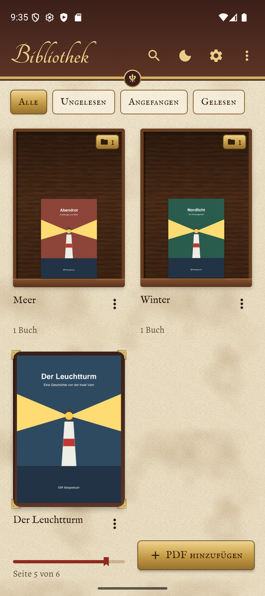
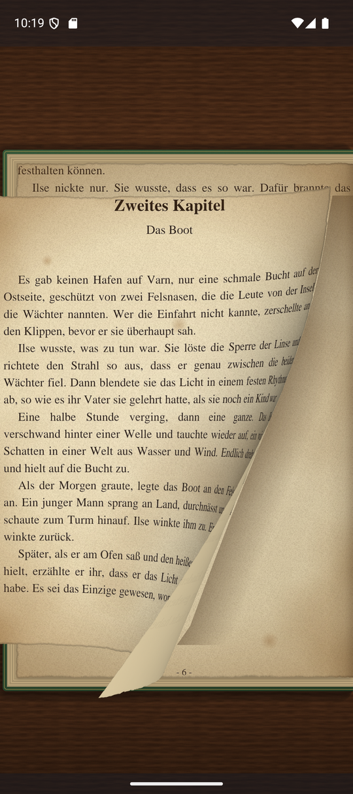
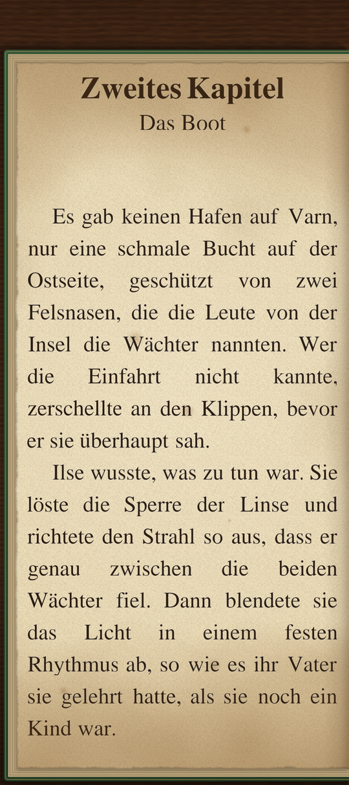
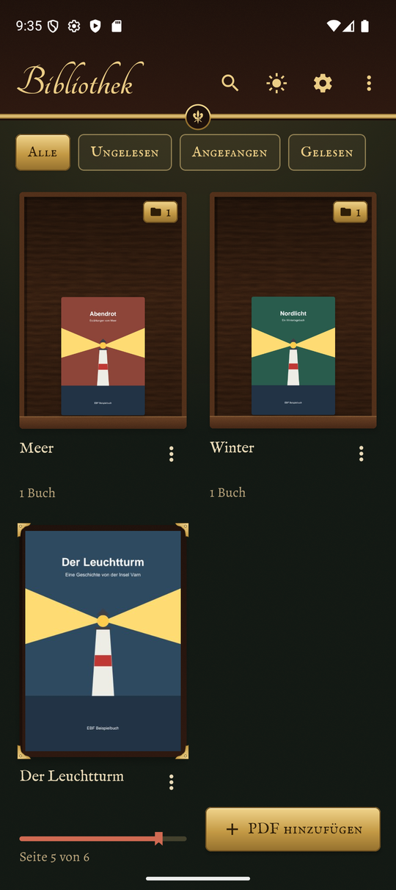

  

<h1 align="center">Easy Books</h1>

  Read PDFs like a book – with real page turns, folders, search and dark mode. 
  For Android and iPhone. Free, no account, fully offline.

  
  &nbsp;
  

  <a href="#install-on-android">Install on Android</a> ·
  <a href="#install-on-iphone">Install on iPhone</a> ·
  <a href="#first-steps">First steps</a> ·
  <a href="https://github.com/MoFrei98/EasyBooks/releases">All releases</a>

 

  
  &nbsp;
  
  &nbsp;
  
  &nbsp;
  

Android: library, page turn, large print and dark mode · The app is in German

## Features

- **Looks like an old library** (Android): folders are wooden shelves and books are bound in leather with brass corners. In the view *Altes Buch* (old book, the default) an open book lies on the table: aged paper with slightly frayed edges, from a left page to the right one your eyes just move on, and only after a right page you turn the leaf. If the first page is a picture, it becomes the hard cover, which opens with a creak and a soft thud. Prefer it plain? Choose the view *Slideshow*. The iPhone app keeps its plain look.
- **Pages that turn like paper**, with an optional soft rustle – or a simple slideshow if you prefer.
- **Three text sizes, nothing cut off.** *Klein* shows the whole page, *Normal* trims the white margins, and *Groß* reflows the text in large print like an e-book – even for scanned books.
- **Your own folders.** Easy Books shows the PDFs in a folder on your device, with subfolders as shelves. Sorting a book into a folder moves the file.
- **Title, author and year** are filled in automatically and can be edited.
- **Search and filters** across all folders: unread, started, finished.
- **Dark mode** for the app and the pages – on Android a library by night, with dark wood and warm brass.
- **Picks up where you left off** in every book.
- **Open PDFs from other apps** with *Open with* (Android) or *Share* (iPhone).
- **Private.** No account, no ads, no tracking, and no internet connection at all.

## Install on Android

You need Android 8.0 or newer.

1. On your phone, open the **[latest release](https://github.com/MoFrei98/EasyBooks/releases/latest)** and tap **`EasyBooks-<version>.apk`** under **Assets**.
2. Open the downloaded file, for example from the download notification or in **Files → Downloads**.
3. The first time, Android asks whether your browser may install apps. Tap **Settings → Allow from this source**, go back and tap **Install**.
4. If Google Play Protect warns about an unknown app, tap **More details → Install anyway**. The warning appears because the app does not come from the Play Store.

**Updating:** download the new version and install it over the old one. Your library, reading progress and settings are kept. This also works if you still have the app under its old name **EBF**.

## Install on iPhone

You need iOS 17 or newer, a Windows PC or Mac, a USB cable and an Apple ID.

Easy Books is not in the App Store. Apple only lets an iPhone run apps that are signed for it, so you install Easy Books with **[Sideloadly](https://sideloadly.io)**, a free tool that signs the app with your Apple ID and copies it to your iPhone.

1. On your computer, open the **[iPhone release](https://github.com/MoFrei98/EasyBooks/releases/tag/ios-v1.1)** and download **`EasyBooks-ios-<version>.ipa`** under **Assets**.
2. Install [Sideloadly](https://sideloadly.io). On Windows, also install **iTunes** and **iCloud** from Apple's website (not from the Microsoft Store), as Sideloadly's instructions describe.
3. Connect your iPhone with the USB cable, unlock it and tap **Trust** if it asks.
4. Drag the `.ipa` file into Sideloadly, enter your Apple ID and click **Start**.
5. On the iPhone, open **Settings → General → VPN & Device Management**, tap your Apple ID and trust it. If iOS asks for it, turn on **Settings → Privacy & Security → Developer Mode** and restart the iPhone.

**Good to know**

- **Your Apple ID:** Sideloadly uses it only to get a free signing certificate from Apple. If you'd rather not enter your main Apple ID in a third-party tool, create a second, free Apple ID just for this – it works the same way.
- **Every 7 days:** with a free Apple ID, Apple lets the app run for 7 days. After that, install it again the same way. Your library and reading progress stay.
- **Updating:** install the new version the same way. It replaces the old one, also if it is still called **EBF**, and keeps your library.
- The iPhone version is still a **pre-release**: it has been tested in the iOS simulator, not yet on many real iPhones.

## First steps

**Android:** on the first start tap **Bibliotheksordner wählen** (choose library folder). In the folder picker, create a folder such as `Easy Books` with the folder icon at the top, open it, tap **Use this folder** and allow access. PDFs and subfolders in it appear in the app. You can also skip this and just tap **PDF hinzufügen** (add PDF).

**iPhone:** nothing to set up. Your library is the folder **On My iPhone › Easy Books** in the Files app. Put PDFs there, or open a PDF in another app and choose **Share → Easy Books**.

**Reading:** swipe or tap the right or left edge to turn the page. Tap the middle to show the toolbars, use the slider to jump to any page. Text size, design (light/dark) and the view (on Android *Slideshow* or *Altes Buch*) are in the settings (gear icon).

## Privacy

Easy Books works completely offline. The Android app has no internet permission, and the iPhone app contains no network code. There is no account, no analytics, no ads and no crash reporting. Your library and reading progress are stored only on your device, and your PDFs stay normal files in your folder.

## Support

Found a bug or have an idea? [Open an issue](https://github.com/MoFrei98/EasyBooks/issues).

> [!NOTE]
> Easy Books is a hobby project. Its code was written almost entirely by an AI assistant (Claude) with only light human review ("vibe coded"). It has not been audited or tested on many devices. Use it at your own risk and keep backups of your PDFs.
